+++
title = "Time-series storage engine"
+++

### Writing a Time Series Database from Scratch
#### Time series data
- Time series: identifier & stream of samples/data points as tuples `(timestamp: time, value: float64_t)`, e.g. `identifier -> (t0, v0), (t1, v1), (t2, v2), (t3, v3), ...`
- Identifier: metric name with dictionary of label dimensions, e.g. `requests_total{path="/status", method="GET", instance=”10.0.0.1:80”}` or `{__name__="requests_total", path="/status", method="GET", instance=”10.0.0.1:80”}`
- Query by selecting labels and time window
#### Writing pattern
```diagram
series
  ^   
  │   . . . . . . . . . . . . . . . . .   . . . . .   {__name__="request_total", method="GET"}
  │     . . . . . . . . . . . . . . . . . . . . . .   {__name__="request_total", method="POST"}
  │         . . . . . . .
  │       . . .     . . . . . . . . . . . . . . . .                  ... 
  │     . . . . . . . . . . . . . . . . .   . . . .   
  │     . . . . . . . . . .   . . . . . . . . . . .   {__name__="errors_total", method="POST"}
  │           . . .   . . . . . . . . .   . . . . .   {__name__="errors_total", method="GET"}
  │         . . . . . . . . .       . . . . .
  │       . . .     . . . . . . . . . . . . . . . .                  ... 
  │     . . . . . . . . . . . . . . . .   . . . . 
  v
    <-------------------- time --------------------->
```
- Prometheus retrieves in batch from _targets_ concurrently as samples from each targets are independent. A Prometheus instance collects data points from tens of thousands of targets, each with hundreds to thousands of time series
- Batch writing larger chunks of data is needed. While SSDs are fast for random writes, they only write in pages of 4KiB—writing 16 byte is equivalent to full 4KiB—which is known as [write amplification](https://en.wikipedia.org/wiki/Write_amplification)
- Querying pattern ≠ writing pattern, we can query a single data point from a significantly large number of series
```diagram
         +------+------+------+------+
         | t1   | t2   | t3   | t4   |
         |------|------|------|------|
series a | a1   | a2   | a3   | a4   |
series b | b1   | b2   | b3   | b4   |
series c | c1   | c2   | c3   | c4   |
series d | d1   | d2   | d3   | d4   |
         +------+------+------+------+
          Batch1 Batch2 Batch3 Batch4
```
- Batch writes => vertical sets of data, querying data points for a series over a time window is slow, since we're reading from random pages
- Samples from same series should be stored sequentially => scanning with few reads
- Problem: fast write from data to disk & efficient layout for queries
#### Prometheus's (current) V2 storage
- Create one file per time series that contains all of its samples in sequential order
- Writing single samples is expensive => batch writing of 1KiB chunks of samples for a series in memory, then flush to files
- Sample changes very little with previous sample => enables compression format
- Gorilla TSDB's compression format: 16 byte => 1.37 byte sample on average
```diagram
   ┌──────────┬─────────┬─────────┬─────────┬─────────┐           series A
   └──────────┴─────────┴─────────┴─────────┴─────────┘
          ┌──────────┬─────────┬─────────┬─────────┬─────────┐    series B
          └──────────┴─────────┴─────────┴─────────┴─────────┘ 
                              . . .
 ┌──────────┬─────────┬─────────┬─────────┬─────────┬─────────┐   series XYZ
 └──────────┴─────────┴─────────┴─────────┴─────────┴─────────┘ 
   chunk 1    chunk 2   chunk 3     ...
```
- Keeping a separate file for each series is problematic => a lot more files are needed than the number of time series
- Millions of files => run out of [inodes](https://en.wikipedia.org/wiki/Inode), reformatting disks is disruptive
- Every second, thousands of chunks are flushed to different places, high write load => slower
- DB can't keep files opened as they use OS entries, files are closed => querying old data must open thousands of files => slow
- Caching hides slowness, caching too aggressively => increases memory use
- Old data has to be deleted by removing it from the front of the files => write intensive & further write amplification
- Head chunk (not full) are held in memory => data loss if app crashes
- Prevent by periodically checkpointing memory to disk => slow, recovery from checkpoint is also slow
#### Series Churn
- Series churn: inactive set of time series, i.e. receives no more data points
- For example, performing a rolling update on microservices instances that generate the time series introduces series churn
- This may happen frequently by systems like Kubernetes
```diagram
series
  ^
  │   . . . . . .
  │   . . . . . .
  │   . . . . . .
  │               . . . . . . .
  │               . . . . . . .
  │               . . . . . . .
  │                             . . . . . .
  │                             . . . . . .
  │                                         . . . . .
  │                                         . . . . .
  │                                         . . . . .
  v
    <-------------------- time --------------------->
```
- Infrastructure remains constant while time series grows linearly
- No issues on collecting data, but bad query performance
#### Prometheus's (current) V2 storage
- Prometheus uses an index based on [LevelDB](https://github.com/google/leveldb), which allows querying series on a label pair
- Combining results from different label selections, i.e. two or more predicates, has scalability problems
#### Resource consumption
- As chunks slowly piled up, memory consumption ramp up
- Once completed, they are written to disk and evicted from memory => memory usage reaches a steady state
- But until then, *series churn* increases memory usage every time scaling or rolling update is performed
- Transition periods can last hours long & it's hard to estimate max resource needed
- Single file per time series => single query can take up a Prometheus process
- Querying data not cached in memory => files for queried series are opened & chunks of relevant data are read into memory
- If data > memory, Prometheus is killed by kernel OOM killer ([SIGKILL](https://man7.org/linux/man-pages/man1/kill.1p.html))
- Data can be evicted from memory after a query, but it's generally cached much longer for subsequent queries
- Write amplification may still exist by having too small write batches & not aligning data precisely on page boundaries
#### Prometheus's (new) V3 storage
- The macro layout of the storage:
```diagram
$ tree ./data
./data
├── b-000001
│   ├── chunks
│   │   ├── 000001
│   │   ├── 000002
│   │   └── 000003
│   ├── index
│   └── meta.json
├── b-000004s
│   ├── chunks
│   │   └── 000001
│   ├── index
│   └── meta.json
├── b-000005
│   ├── chunks
│   │   └── 000001
│   ├── index
│   └── meta.json
└── b-000006
    ├── meta.json
    └── wal
        ├── 000001
        ├── 000002
        └── 000003
```
- Numbered blocks are prefixed with `b-`
- Each block holds an index and chunks of data points of a series
- Just like V2, this makes reading series over a time window cheap & allows compression, e.g. series: `1000, 1015, 1030`—only the first timestamp and difference are stored, using very few bits
- Index files allow finding labels, their possible values, the entire series, and the chunks of a series
#### Horizontal Partitioning
- Partition the time space into non-overlapping blocks
- Each block is a fully independent DB of all time series for its time window
```diagram
t0          t1          t2          t3          now
┌─────────┐ ┌─────────┐ ┌─────────┐ ┌─────────┐
│         │ │         │ │         │ │         │            ┌────────────┐
│         │ │         │ │         │ │ mutable │ <─ write ─ ┤ Prometheus │
│         │ │         │ │         │ │         │            └────────────┘
└─────────┘ └─────────┘ └─────────┘ └─────────┘                 ^
     └───────────┴─────┬─────┴───────────┘                      │
                       │                                      query
                       │                                        │
                     merge ─────────────────────────────────────┘
```
- Every block is immutable except the currently written one
- New data is written to in-memory DB & temporary [WAL](https://en.wikipedia.org/wiki/Write-ahead_logging)
- Fan out queries to relevant blocks => merge partial results from each block
- Benefits:
	- Ignore data blocks outside of the queried time range
	- Complete a block by persisting data from in-memory DB sequentially
	- Recent chunks which are queried most are in memory
	- No longer bounded by the fixed 1KiB chunk size
	- Delete old data => delete a single directory
#### mmap
- Millions of small files => a few of large files, allows us to keep all files open
- The open files can be mapped with [mmap(2)](https://man7.org/linux/man-pages/man2/mmap.2.html), a syscall that maps files into a process's virtual memory address space
- `mmap` lets the OS manages the memory: it loads pages when a query reads them, drops pages if another program needs the RAM
- Cache size is now adaptive => large query won't cause OOM kill anymore
#### Compaction
- Periodically: cut a new head block => persist the completed block to disk => delete its WAL
- Keep each block short (typically 2 hrs) => avoids having too much data in memory
- Querying multiple blocks => merge partial results, costly for long query
- Compaction: combining blocks into a potentially larger block
- Side effect: dropping deleted data, restructuring chunks for improved query performance
```diagram
t0             t1            t2             t3             t4             now
 ┌────────────┐  ┌──────────┐  ┌───────────┐  ┌───────────┐  ┌───────────┐
 │ 1          │  │ 2        │  │ 3         │  │ 4         │  │ 5 mutable │    before
 └────────────┘  └──────────┘  └───────────┘  └───────────┘  └───────────┘
 ┌─────────────────────────────────────────┐  ┌───────────┐  ┌───────────┐
 │ 1              compacted                │  │ 4         │  │ 5 mutable │    after (option A)
 └─────────────────────────────────────────┘  └───────────┘  └───────────┘
 ┌──────────────────────────┐  ┌──────────────────────────┐  ┌───────────┐
 │ 1       compacted        │  │ 3      compacted         │  │ 5 mutable │    after (option B)
 └──────────────────────────┘  └──────────────────────────┘  └───────────┘
```
- `[1,2,3,4]` can be compacted to `[1,4]` or `[1,3]` => reduces merging cost
#### Retention
- Drop old data => delete blocks outside the retention window
- Block 1 can safely be deleted while 2 has to wait until it's fully behind the boundary
```diagram
                      |
 ┌────────────┐  ┌────┼─────┐  ┌───────────┐  ┌───────────┐  ┌───────────┐
 │ 1          │  │ 2  |     │  │ 3         │  │ 4         │  │ 5         │   . . .
 └────────────┘  └────┼─────┘  └───────────┘  └───────────┘  └───────────┘
                      |
                      |
             retention boundary
```
- Older data => larger blocks, as we keep compacting previously compacted blocks
- Upper limit => blocks don't span the entire DB & limits disk overhead of blocks that are partially inside & outside of retention window, i.e. block 2 above
- Max block size at 10% retention window => disk overhead is bounded by 10%
- Retention deletion goes from very costly to practically free
#### Indexes
- Block-based layout reduces the number of series to be considered when querying
- It only reduces by a constant factor: *O(n)* => *O(n/c)* ~ *O(n)*
- It's significantly faster in most queries, except queries spanning the full time range
- [Inverted index](https://en.wikipedia.org/wiki/Inverted_index): `index[app="nginx"] = [10,29,9]`, series IDs that have a label `app="nginx"`
- If n = number of series, m = result size for a given query => time complexity of the query using inverted index is *O(m)*, where m is generally significantly smaller
- Things become problematic with more complex queries, i.e. combined labels
#### Combining Labels
- `__name__="requests_total" AND app="foo"`: take the inverted index list for each and intersect them
- Each input list has worst case size *O(n)* => taking the intersection takes *O(n^2)*
- Adding more labels increases the exponent to *O(n^3), O(n^4), ..., O(n^k)*
```diagram
__name__="requests_total"   ->   [ 9999, 1000, 1001, 2000000, 2000001, 2000002, 2000003 ]
     app="foo"              ->   [ 1, 3, 10, 11, 12, 100, 311, 320, 1000, 1001, 10002 ]
             intersection   ->   [ 1000, 1001 ]
```
- Sorted inverted indexes => scanning both lists takes *O(2n) ~ O(n)*
- For k lists, it now takes *O(nk)* instead of *O(n^k)*
- This is a simplified version of canonical search index used by [search engines](https://en.wikipedia.org/wiki/Search_engine_indexing#Inverted_indices)
- Keeping IDs sorted is non-trivial, e.g. V2 assigns hashes as IDs to new series
- Another problem: modifying indexes on disk as data gets deleted or updated
- Approach: simply recompute and rewrite them while keeping the DB queryable and consistent
- V3 does this by having separate immutable index per block, only modified via rewrite on compaction
- Only indexes for mutable blocks are held in memory to be updated
#### Benchmarking
- Ran two Prometheus 1.5.2 servers (V2 storage) and two Prometheus 2.0 servers (V3 storage) over 12 hrs
- In most graphs, there's a spike in Prometheus 1.5.2 which aligns with the retention boundary at 6 hrs

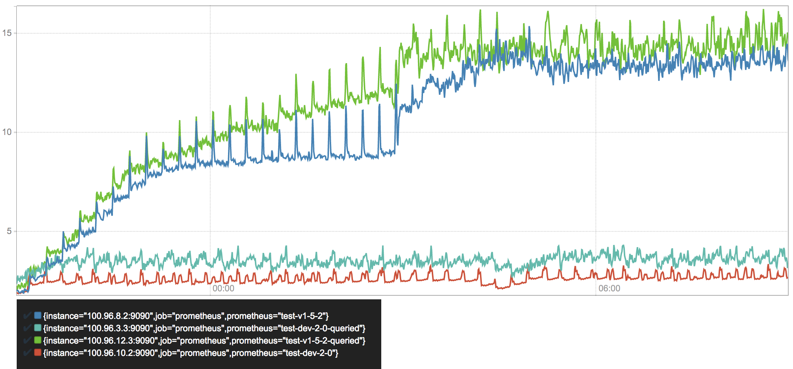
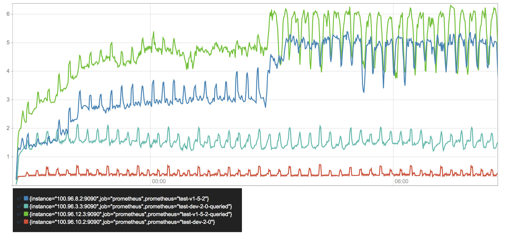
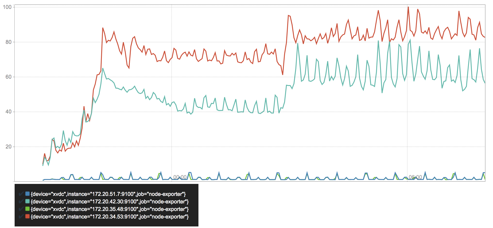
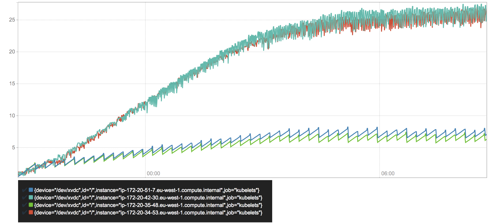
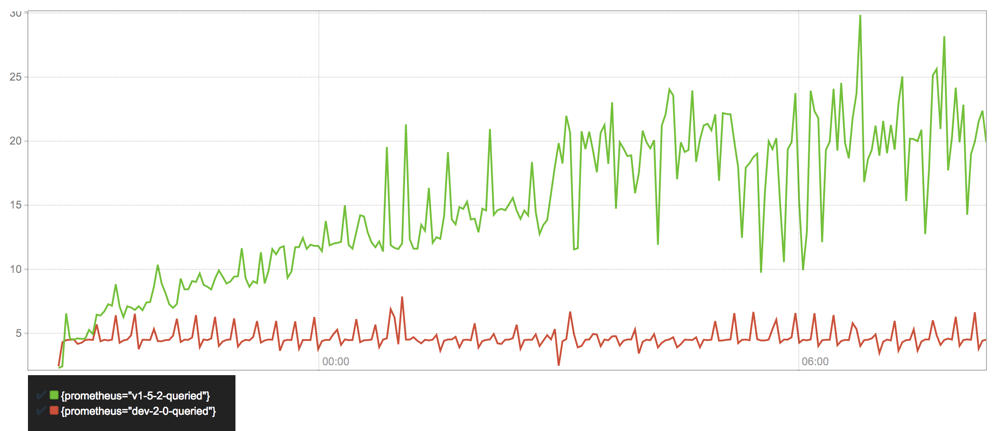
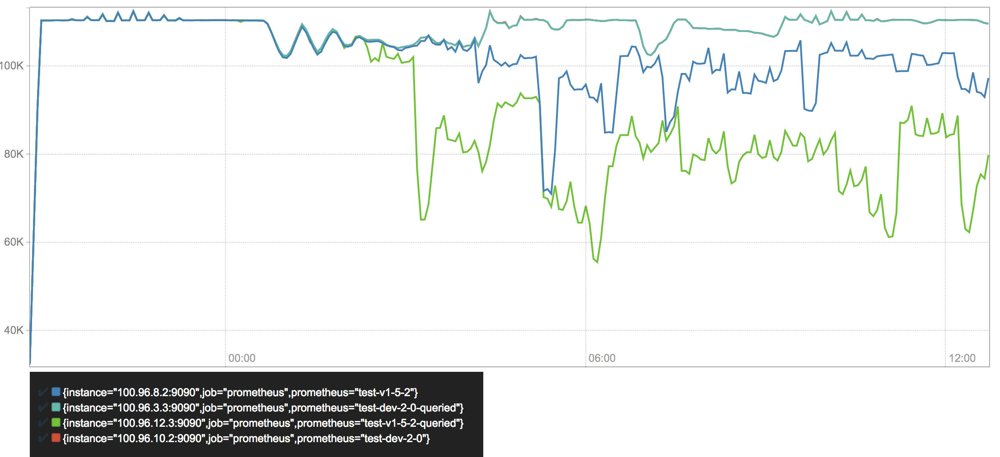

---
### Prometheus TSDB
#### The Head Block
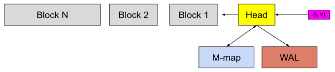
- `(t, v)` => active chunk (head) & WAL => full chunk => disk & memory-mapped => persistent blocks => merged blocks => deleted after retention window



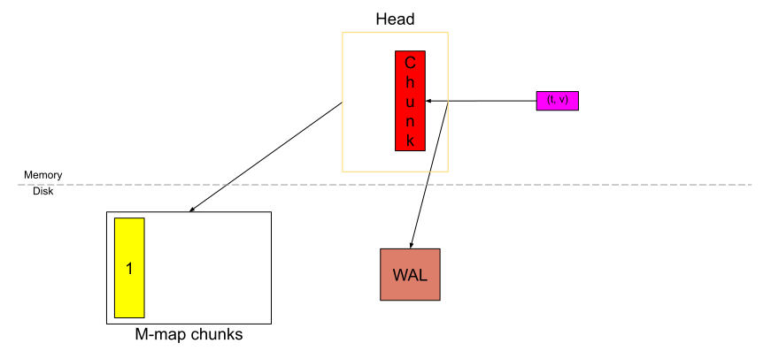

- `mmap` allows dynamically loading chunks into memory with reference by the OS

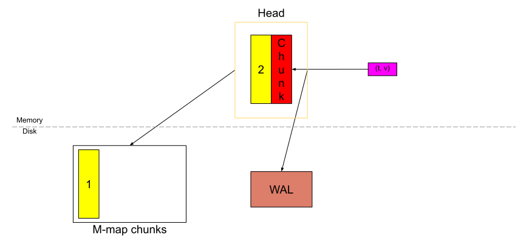
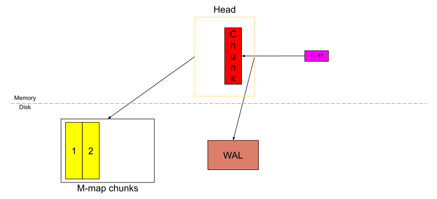
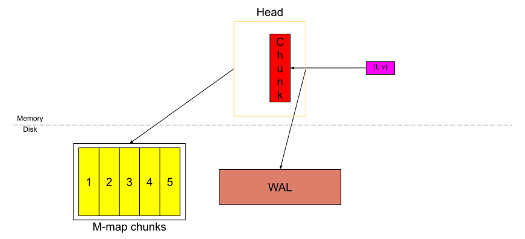
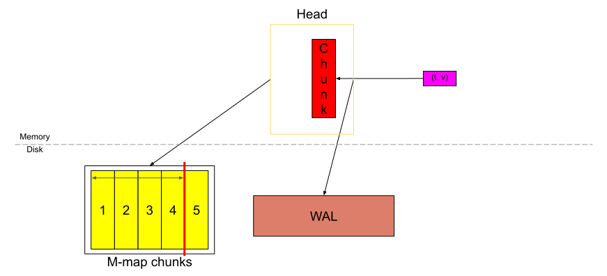
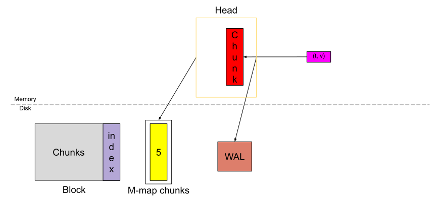

- Chunks => persistent block, WAL is truncated & a "checkpoint" is created
- (inverted) index of the Head is in memory
- Compaction => Head is truncated to remove old chunks => garbage collection removes series that no longer exist in the Head from the index
- Recovery uses on-disk memory-mapped chunks and WAL to reconstruct the in-memory indexes and chunks
- Code references: [tsdb/db.go](https://github.com/prometheus/prometheus/blob/master/tsdb/db.go) & [tsdb/head.go](https://github.com/prometheus/prometheus/blob/master/tsdb/head.go)
#### WAL
- WAL: sequential log of events in DB => records each change before DB applies it
- [Prometheus's WAL](https://github.com/prometheus/prometheus/blob/main/tsdb/docs/format/wal.md) is used on restarts to restore in-memory DB, i.e. the Head block
- Types of records:
	- `Series`: list of (series reference, list of label values)
	- `Samples` : list of (series reference, list of samples of that series in write request)
	- `Tombstones` : list of (deleted series reference, time ranges)
- `Series` is written once, `Samples` is written for every write request
- `Series` is written before `Samples` that refers to it => enables replay
- `Samples` is written to WAL before going into the Head
- Delete by writing `Tombstones` into WAL first
```
data
└── wal
    ├── 000000
    ├── 000001
    └── 000002
```
- WAL is stored as a sequence of numbered files (segment) of 128MiB each
- Old WAL segments need to be deleted over time
- WAL truncation is done after Head truncation
- DB deletes first N contiguous segments 
- Random write requests => not easy to find the time window of each segment => delete 2/3 of the segments
- Blindly deleting segments => lose records => solve by checkpointing 
#### Checkpointing
- Checkpoint is a filtered copy of WAL segments that DB is about to delete:
  - Drop `Series` records for series which are no longer in Head
	- Drop `Samples` which are before time `T`
	- Drop `Tombstones` for time windows before `T`
	- Keep the remaining `Series`, `Samples` & `Tombstones`
- A drop can be a rewrite as one record may hold several series or samples
```
data
└── wal
    ├── checkpoint.000003
    |   ├── 000000
    |   └── 000001
    ├── 000004
    └── 000005
```
- `checkpoint.X` records the last segment that it covers => DB replays the latest checkpoint and continues from segment `X+1` on restart
- Replay creates series from `Series` records & add samples from `Samples` records to them, using the reference
- Code references: [`tsdb/record/record.go`](https://github.com/prometheus/prometheus/blob/master/tsdb/record/record.go), [`tsdb/wlog/wlog.go`](https://github.com/prometheus/prometheus/blob/master/tsdb/wlog/wlog.go) & [`tsdb/wlog/checkpoint.go`](https://github.com/prometheus/prometheus/blob/master/tsdb/wlog/checkpoint.go)
#### Memory Mapping of Head Chunks from Disk
---
### Gorilla: A Fast, Scalable, In-Memory Time Series Database
#### Section 4.1, the compression section
#### The design goals list (in the introduction)
---
Sources:
1. https://fabxc.org/tsdb/ | https://web.archive.org/web/20210803115658/https://fabxc.org/tsdb/
2. https://ganeshvernekar.com/blog/prometheus-tsdb-the-head-block/
3. https://ganeshvernekar.com/blog/prometheus-tsdb-wal-and-checkpoint/
4. https://ganeshvernekar.com/blog/prometheus-tsdb-mmapping-head-chunks-from-disk/
5. https://www.vldb.org/pvldb/vol8/p1816-teller.pdf